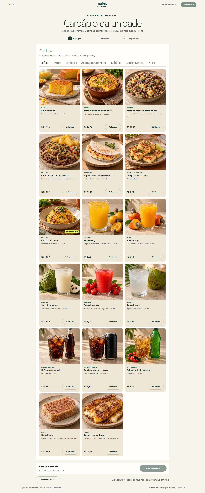

# Raízes do Nordeste

> Protótipo de pedidos digitais e qualidade de software para uma rede de franquias alimentícias.

**React · TypeScript · Node.js · Playwright**

## O projeto

A aplicação demonstra a jornada de pedido, da escolha da unidade ao comprovante. O foco é exercitar regras de negócio e qualidade com testes executáveis e resultados observáveis. Catálogo, fidelidade e pagamento são simulados; nenhum pagamento real é processado.



### Jornada do cliente

1. Escolhe uma unidade disponível.
2. Navega pelo cardápio e ajusta os itens do carrinho.
3. Revisa o pedido e escolhe retirada ou consumo na unidade.
4. Confirma usando o pagamento simulado.
5. Recebe o comprovante com itens, valores e senha de retirada.

| Rota | Tela |
|---|---|
| `/` | Apresentação e escolha da unidade |
| `/cardapio` | Produtos, categorias e carrinho |
| `/checkout` | Resumo, modalidade e pagamento simulado |
| `/comprovante` | Confirmação, itens, total e retirada |

## Tecnologias

| Parte | Tecnologia |
|---|---|
| Interface | React, TypeScript estrito, Vite e CSS |
| API e domínio | Node.js 24, JavaScript ESM e HTTP nativo |
| Testes | `node:test`, Playwright e axe-core |
| Dados externos | Adaptadores simulados; pedidos guardados em memória |

O checkout web envia o canal `WEB` automaticamente. A API também valida outros canais para os cenários de teste.

## Executar localmente

Requisito: Node.js 24 ou superior.

```powershell
npm install
npm run dev
```

Abra `http://127.0.0.1:5173`. A unidade Recife Centro aceita pedidos; Natal Norte fica indisponível para testar o tratamento de falhas.

Para compilar e servir a versão local de produção:

```powershell
npm start
```

## Verificações

```powershell
npm run lint
npm run check
npm test
npm run test:coverage
npx playwright install chromium
npm run test:e2e
npm audit --audit-level=high
```

Última validação local, em 26/10/2026: 22/22 testes unitários e de integração, 5/5 testes E2E, cobertura de 89,41% das linhas e 84,27% dos branches, e auditoria sem vulnerabilidades.

### Carga local

```powershell
npm run load:local -- --vus 500 --warmup 5 --duration 30 --ramp-down 5
```

Na execução registrada: 146.101 requisições, sem erros; p95 de 149,67 ms para pedidos na fase estável. É uma medição local, não uma garantia de desempenho em produção.

## Estrutura

- `frontend/` — interface React e TypeScript.
- `src/` — API, regras de negócio e adaptadores.
- `test/` e `e2e/` — testes de domínio, API e jornada no navegador.
- `scripts/` — servidor de desenvolvimento e carga.
- `evidencias/` — logs, screenshots e resultados reais.
- `docs/` — requisitos, arquitetura, QA, testes, métricas, privacidade e conformidade.

A documentação começa pelo [plano de execução](docs/00-plano-de-execucao.md) e pelo [resumo do projeto](docs/01-projeto.md). Os resultados estão no [relatório final](docs/relatorio-final-conformidade.md).

## Limites conhecidos

O armazenamento é volátil: reiniciar o servidor remove os pedidos. Não há integração real com pagamento, estoque, fidelidade ou sistemas de franquia. O protótipo está pronto para demonstração e avaliação; não para operação comercial.

## Uso de IA

A IA foi utilizada para auxiliar na implementação de algumas funcionalidades do projeto.
