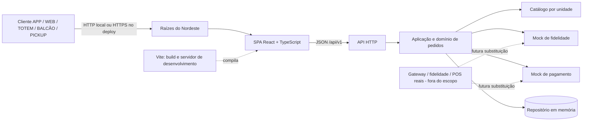
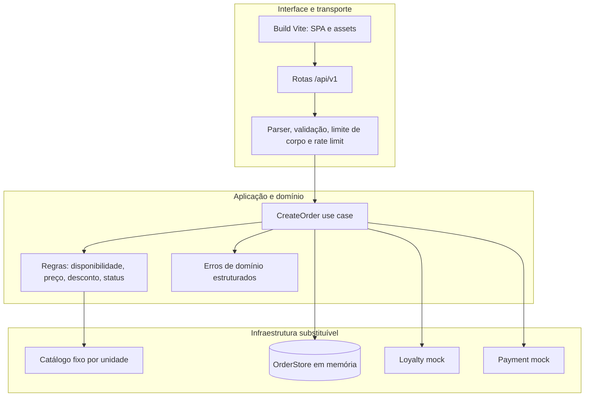
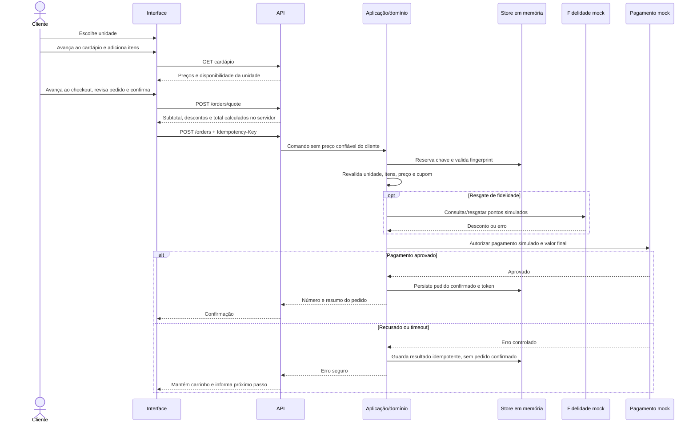
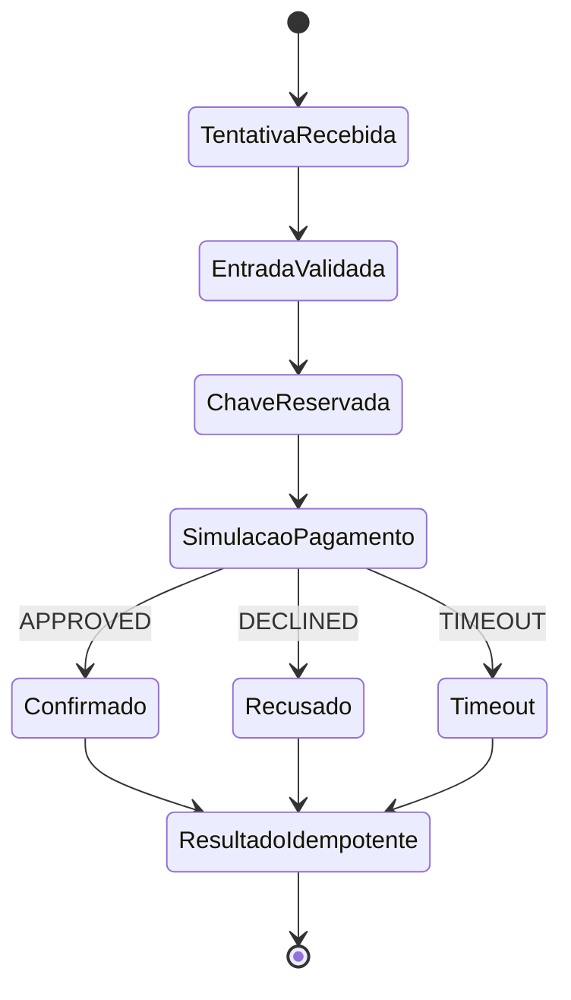
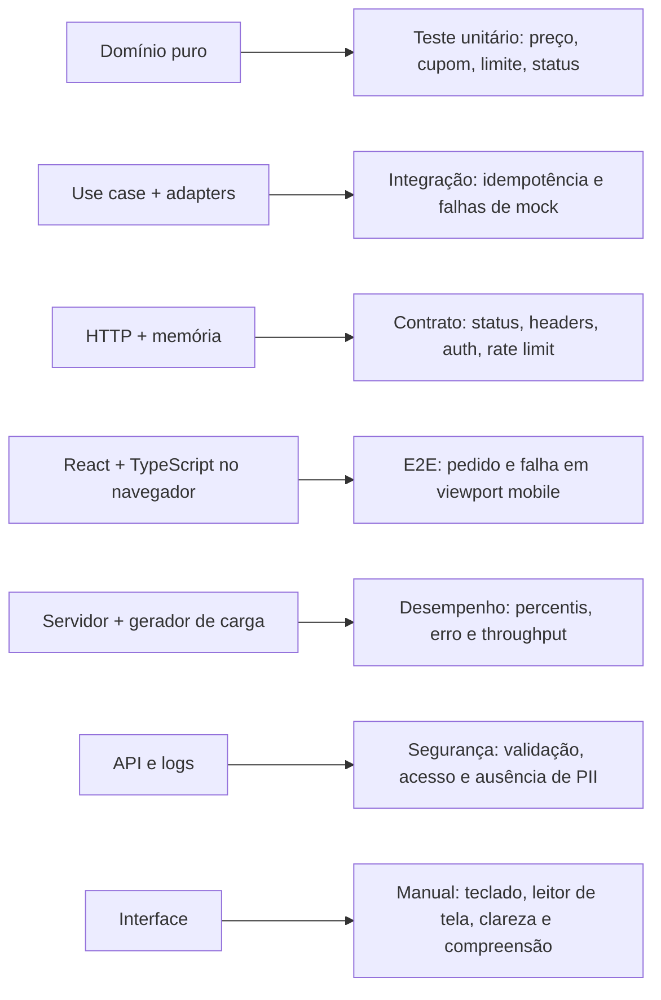

# Arquitetura

## Visão e contexto

Protótipo de monólito modular com API em Node.js 24 e JavaScript ESM, e SPA em React + TypeScript estrito compilada por Vite. O build da interface fica em `dist/client`; o servidor HTTP nativo entrega a SPA e a API na mesma origem. No desenvolvimento, Vite roda separado com HMR e encaminha `/api` para o servidor Node. O repositório em memória e os mocks permitem testes rápidos e determinísticos; reinício apaga pedidos, chaves e estado de limite. Persistência em memória é um trade-off didático e bloqueia uso comercial.

A SPA apresenta uma etapa por vez em rotas próprias: LP `/` para escolher unidade, `/cardapio`, `/checkout` e `/comprovante`. O progresso fica visível durante a jornada, e voltar/avançar pelo navegador mantém o estado do pedido na sessão atual.

## Componentes e responsabilidades

## Fluxo de realização do pedido

## Fluxo do pagamento mock

O mock não captura PAN, CVV, token de cartão ou credencial bancária e não efetua liquidação. O seletor de resultado existe exclusivamente para testar estados em ambiente demonstrativo. Antes de produção, substituir por provedor homologado, webhooks autenticados, controle de timeout/reconciliação e armazenamento transacional/outbox; tais itens não fazem parte desta implementação.

## Pontos de teste

## Erros, idempotência e privacidade

- Erros públicos usam `code`, mensagem segura e `requestId`; exceções internas não são serializadas.
- Cada request recebe `X-Request-Id`; logs guardam método, rota normalizada, status e duração, nunca corpo, headers de autenticação ou query sensível.
- O corpo JSON tem limite, validações de enumeração/quantidade/tamanho, rate limit por origem e cabeçalhos de segurança.
- Pedido recuperável exige token aleatório próprio; o token não é incluído em logs. O exemplo retorna o token ao cliente uma vez para permitir consulta anônima controlada.
- Idempotência valida fingerprint do payload e armazena resposta por 24 horas em memória. Em multi-instância precisa de persistência atômica compartilhada e estados de processamento duráveis.

## Escalabilidade e trade-offs

A aplicação é stateless quanto à interface, mas **não** quanto aos pedidos, idempotência ou rate limit: tudo reside no processo. Isso simplifica demonstração e testes, ao custo de perder dados em reinício e não coordenar múltiplas réplicas. Catálogo fixo é suficiente para validar contrato, mas não substitui integração de estoque/preço nem cache com invalidação. Um banco relacional, transação/outbox, autenticação institucional, observabilidade centralizada, TLS e gestão de segredos são pré-requisitos de produção, não funcionalidades alegadas aqui.
